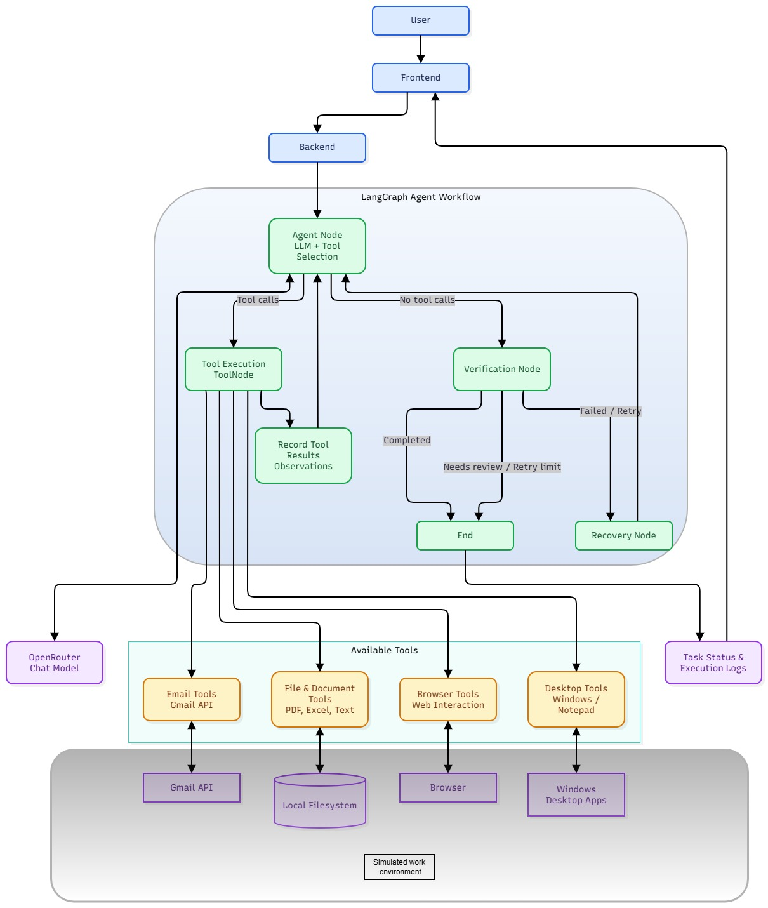

# XeCute : Autonomous AI Task Worker

An AI-powered task automation agent built with Python, LangGraph, and LangChain. The agent interprets natural-language instructions, selects tools, executes tasks, and verifies the results. A Streamlit interface provides a simple way to submit tasks and view execution logs.

## Features

- **LLM-driven task execution:** Uses a LangGraph agent loop to select and execute tools based on the user's goal.
- **Email integration:** Search Gmail messages, read email content, list attachments, and download invoice attachments.
- **Document processing:** Extract text from PDFs and read supported text and spreadsheet files.
- **File operations:** List workspace files and create or write files.
- **Browser automation:** Open pages, inspect page text, click elements, and fill form fields through browser tools.
- **Desktop automation:** Discover and inspect Windows applications, focus windows, interact with controls, and type text.
- **Task verification:** Evaluate execution evidence and retry or request review when completion cannot be confirmed.
  

## Tech Stack

- Python
- [uv](https://docs.astral.sh/uv/) — dependency and project management
- [LangGraph](https://docs.langchain.com/oss/python/langgraph/overview) — agent workflow orchestration
- [LangChain](https://www.langchain.com/) — model and tool integration
- OpenRouter - access to compatible chat models
- playwright - browser access
- Streamlit - user interface
- Gmail API - email and attachment access
- PyMuPDF - PDF text extraction
- pywinauto - Windows desktop automation

## Architecture



The application uses a tool-calling agent orchestrated by LangGraph.

1. **Task input:** The user submits a natural-language task.
2. **Planning and tool selection:** The model decides which available tools are relevant.
3. **Tool execution:** The graph executes selected tools for email, files, PDFs, browsers, or desktop applications.
4. **Observation:** Tool results are added to the agent's execution context.
5. **Verification:** The workflow evaluates available evidence to determine whether the task succeeded.
6. **Recovery or completion:** The agent may retry unsuccessful steps or finish with a completion or review status.


## Project Structure

```text
ai-task-agent/
├── app.py                # Streamlit UI
├── main.py               # Backend entry point
├── agent.py              # LangGraph agent and verification workflow
├── tools.py              # File and document tools
├── email_tools.py        # Gmail and attachment tools
├── browser_tools.py      # Browser automation tools
├── desktop_tools.py      # Windows desktop automation tools
├── pyproject.toml        # Project metadata and dependencies
├── uv.lock               # Locked dependency versions
├── .python-version       # Python version configuration
├── .env                  # Local secrets; do not commit
├── credentials.json      # Local Gmail OAuth credentials; do not commit
├── token.json            # Local OAuth token; do not commit
└── logs/                 # Local execution logs; do not commit
```

The exact contents may vary depending on the current project version.


## Installation

### 1. Clone the repository

```bash
git clone https://github.com/afrozrohan/XeCute.git
cd ai-task-agent
```

### 2. Install dependencies

```bash
uv sync
```

### 3. Configure environment variables

Create a local `.env` file in the project root:

```env
OPENROUTER_API_KEY=your_openrouter_api_key
```

### 4. Configure Gmail API access

To use Gmail tools:

1. Configure a Google Cloud project and enable the Gmail API.
2. Configure OAuth consent and add a test user if the application is in testing mode.
3. Download the OAuth client credentials file.
4. Place the credentials file in the root directory.
5. Run the application and complete the OAuth authorization flow.


## Running the Application

### Run the backend

```bash
uv run python main.py
```

Enter a task when prompted.

Example:

```text
Get the latest invoice email, download its PDF attachment,
read the invoice, and write a summary in summary.tsx.
```

### Run the Streamlit interface

```bash
uv run streamlit run app.py
```

Open the local URL displayed by Streamlit, typically:

```text
http://localhost:8501
```

## Example Use Cases

- Search for the latest invoice in Gmail.
- Download an email attachment to a local folder.
- Extract information from a PDF.
- Summarize a document.
- Write extracted information into a local file.
- Interact with a Windows application through desktop automation.
- Extract itemized invoice details for an expense spreadsheet.
- open url and extract data/open a certain page.


## Current Limitations

- Desktop automation can be sensitive to window focus, UI control names, and Windows application behavior.
- Some UI actions may be difficult to verify automatically.
- Task completion depends on the model's decisions and the reliability of the selected tools.
- Complex or ambiguous tasks may require retries or manual review.
- The initial Streamlit interface focuses on task submission and execution logs; persistent conversational threads and durable task history may require additional implementation.

## Future Improvements

- Persistent conversation threads using LangGraph checkpointing.
- Better Memory and knowledge base systems.
- Better verification of desktop actions.
- Improved task history, execution status, and error reporting.
- Human approval for sensitive or irreversible actions.

